# Jobifyyy — AI-Powered Interview Environment

A full-stack recruitment and interview platform that brings job posting, applications, interview scheduling, live technical interviews, and candidate evaluation into one workflow.

## 🔗 Links

- **Live Demo:** [Open Jobifyyy](https://interview-environment-project.vercel.app/)
- **Backend Repository:** [Jobifyyy Backend](https://github.com/CodeWithAbhay777/Jobifyyy_backend)
- **Frontend Repository:** [Jobifyyy Frontend](https://github.com/CodeWithAbhay777/Interview_Environment_project)

> **Note:** The backend is hosted on Render's free tier, so the first request after a period of inactivity may take a little while while the service wakes up. If the app seems slow at first, wait a moment and try again.

## ✨ What it does

- **Role-based workflows:** Separate experiences for admins, recruiters/interviewers, and candidates.
- **Job and application management:** Admins can create and manage job listings; candidates can browse openings and apply.
- **Interview scheduling:** Organize interviews and manage scheduled, completed, or cancelled sessions.
- **Live interviews:** Supports real-time interview communication, with an interviewer view and candidate answer flow.
- **Collaborative coding:** An in-interview code editor lets interviewers and candidates work through coding questions.
- **Digital whiteboard:** A shared canvas for explaining ideas and solving problems visually.
- **Question management:** Interviewers can browse prepared questions by difficulty and ask them during an interview.
- **Candidate evaluation:** Recruiters can score performance across criteria such as problem-solving, communication, and technical knowledge.
- **AI-assisted feedback and reports:** AI support helps evaluate interview responses and produce a structured performance summary.
- **Background email jobs:** Redis and BullMQ handle asynchronous background processing.

## 🧰 Tech Stack

| Area | Technologies |
|---|---|
| Frontend | React.js, Redux, TanStack Query, Zod |
| Backend | Node.js, Express.js, REST APIs |
| Database | MongoDB Atlas, Mongoose |
| Background jobs and caching | Redis, BullMQ |
| Real-time interview features | Stream SDK, Socket.io / WebRTC |
| AI | OpenAI API |

## 🏗️ Architecture

At a high level, the React frontend communicates with the Express backend through API requests. The backend uses MongoDB Atlas for persistent application data, Redis for fast shared data and job processing, and BullMQ to run asynchronous tasks outside the request-response cycle.

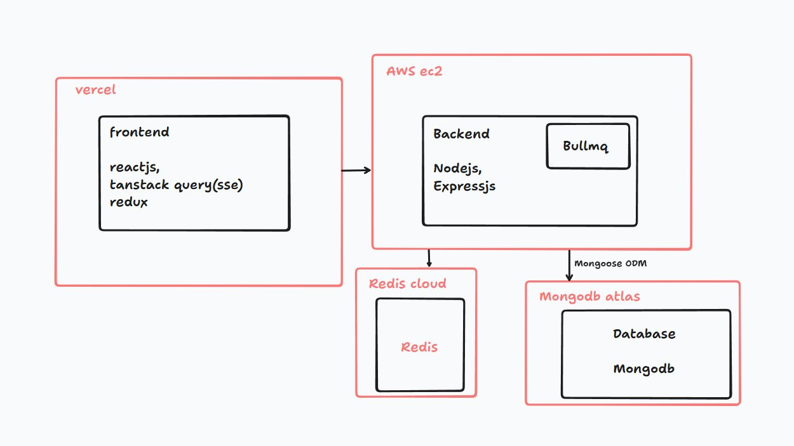

*The diagram is a high-level overview of the application's main components; deployment labels may reflect an earlier deployment setup.*

## 📸 Screenshots

### Landing page
A quick overview of the platform and its interview workflow.

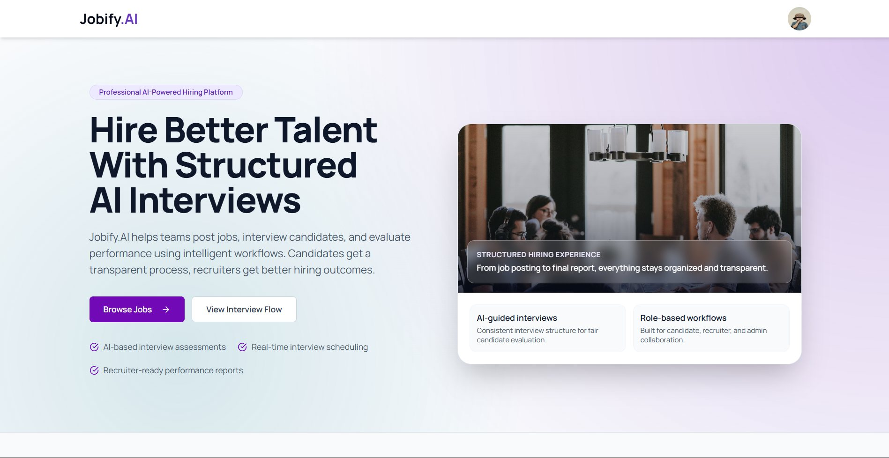

### Sign up
Users can create an account and choose a candidate or recruiter role.

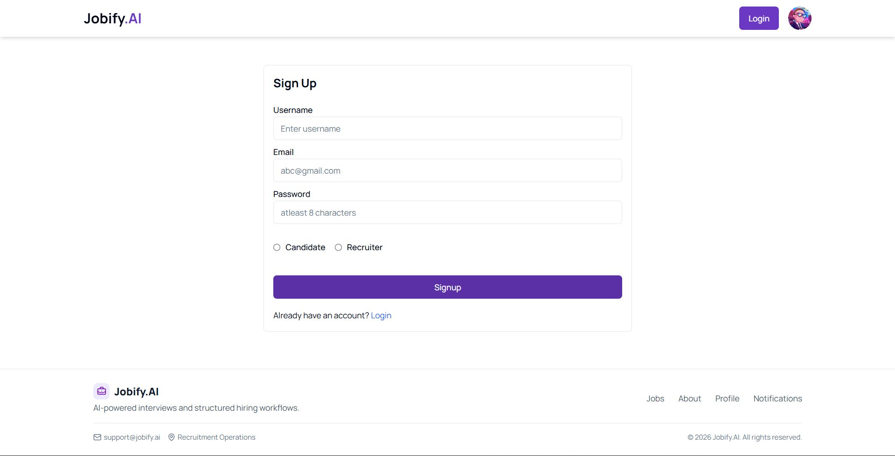

### Admin job dashboard
Admins can review job listings, filter by status or department, and create or edit jobs.

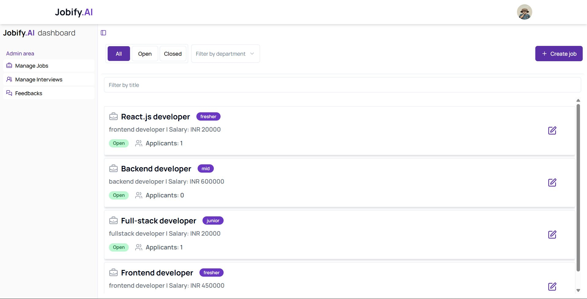

### Interview dashboard
Interviewers can review scheduled and completed interviews and manage upcoming sessions.

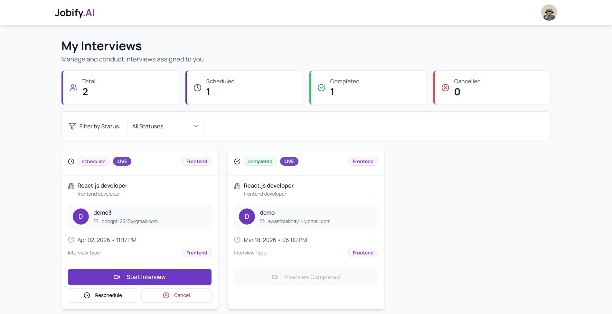

### Job details
Candidates can review a job description, salary, experience level, deadlines, and vacancies before applying.

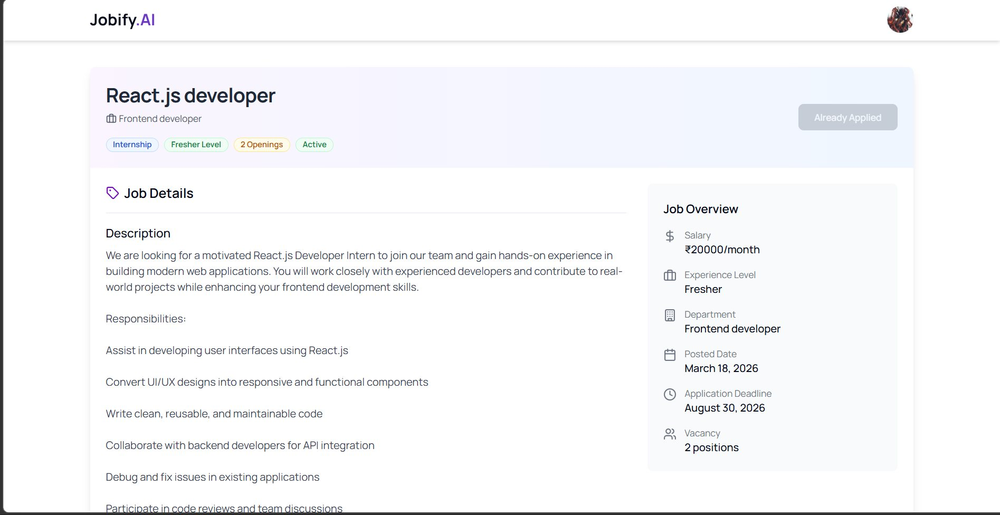

### Live interview room
The interview room provides the video-call workspace and a panel for recording and submitting spoken answers.

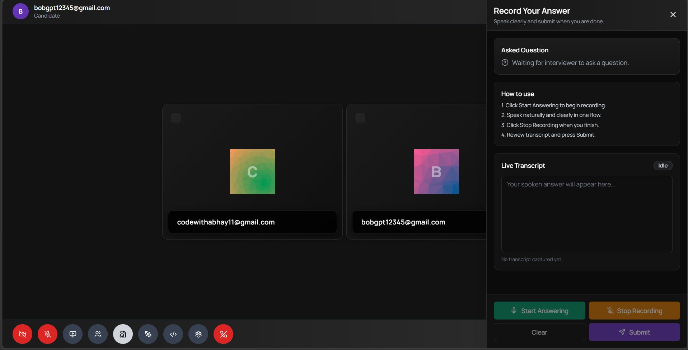

### Live code editor
Interviewers and candidates can write and run code during a technical interview.

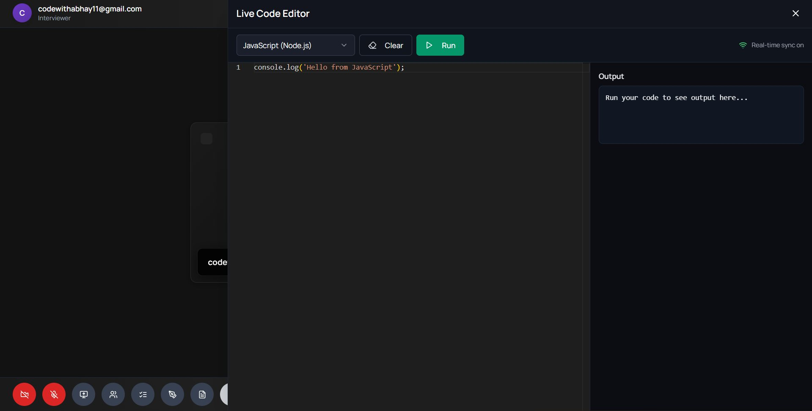

### Collaborative whiteboard
A shared whiteboard supports visual explanations and problem-solving.

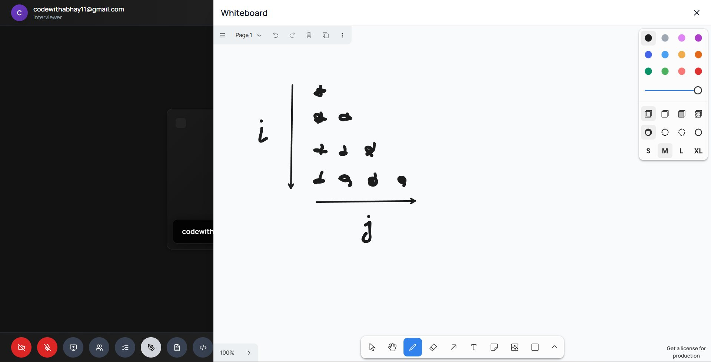

### Interview questions
Interviewers can select prepared questions by difficulty and ask them during the session.

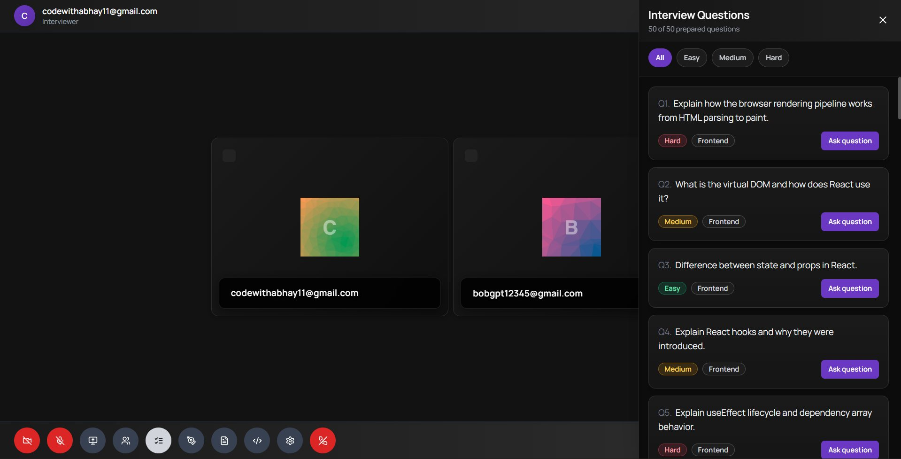

### Candidate evaluation
Interview performance can be scored against structured criteria, with space for a final recommendation.

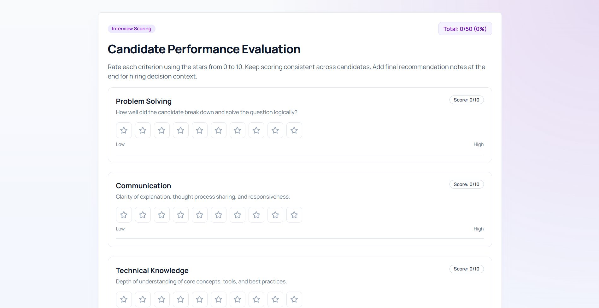

---

Built as a full-stack project to demonstrate practical recruitment workflows, real-time interview tools, and AI-assisted evaluation.
